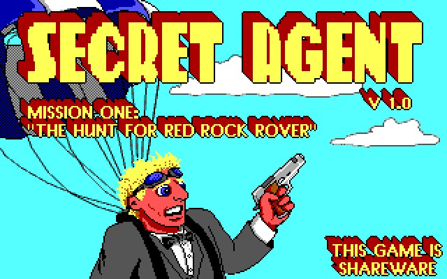
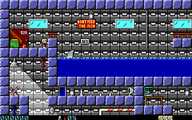
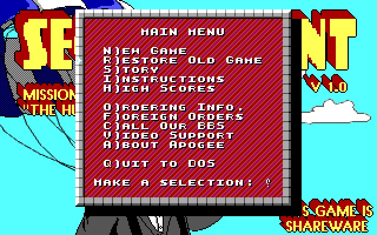
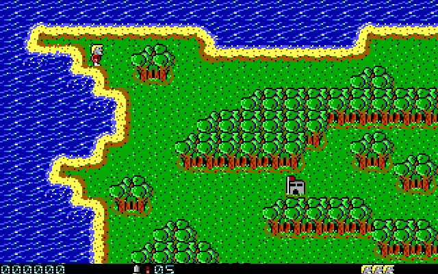
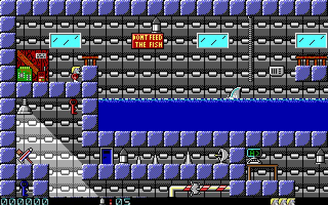
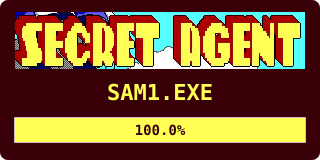

# Secret Agent: a matching decompilation in Turbo Pascal



A rebuild of the DOS platformer **Secret Agent, episode 1: The Hunt for Red
Rock Rover** (Apogee Software, 1992; programmed by Peder Jungck, version 1.0
shareware) as Turbo Pascal source that compiles back to the shipped
`SAM1.EXE`, byte for byte.



The source is `src/match/`: the game's Pascal, one routine per file, and the
assembler blocks it links in. Built with **Turbo Pascal 5.0**, the compiler
the game was built with, it gives the original's load image in all 188,768
bytes. Packed with LZEXE 0.91 the way the shipped file was, it is
`SAM1.EXE` itself, SHA-256 included.

<p>
  
  
  
</p>

All of these are the original `SAM1.EXE`, captured in DOSBox-X.

**The game itself is not included.** You need your own copy (the shareware
episode is enough). Nothing here changes or redistributes the original files.

## Progress

<a href="docs/SAMPROGRESS.HTML"></a>

**All 165 of the game's routines compile to the original's exact bytes, and
all 10 game units are whole.** Borland's System, Crt and Dos units come from
TP 5.0's `TURBO.TPL` unchanged and match too, as does the data segment.

[`docs/SAMPROGRESS.HTML`](docs/SAMPROGRESS.HTML) lists every routine: search
it by name, address or source text, filter it by unit, and click a routine
to read its source. [`PROGRESS.md`](PROGRESS.md) has the same numbers as
tables, part by part and unit by unit. `tools/progress.py` writes all three
from a fresh build of the source, not from hand counts.

## Building and checking

The build needs Turbo Pascal 5.0 (in `.work/toolchains/tp50`), NASM, and the
stock `dosbox` to run the compiler headless. LZEXE 0.91 is needed only for
the last step. None of them is included: `findings/executables.md` says
which versions, and `MATCHING.md` section 1 how they were pinned. The
Python tools run from `.work/venv`.

```sh
./setup.sh                                                   # checks the tools, makes .work/venv
.work/venv/bin/python tools/real/unlzexe.py original/SAM1.EXE .work/tp/SAM1_unp.exe
.work/venv/bin/python tools/tp/gen_scaffold.py   # assemble src/ from src/match/, build with TP 5.0, check the layout
.work/venv/bin/python tools/tp/match.py          # every routine, the libraries and the data against the original
.work/venv/bin/python tools/tp/pack.py           # LZEXE 0.91, compared with original/SAM1.EXE
.work/venv/bin/python tools/progress.py          # rewrite PROGRESS.md and docs/SAMPROGRESS.*
```

`SAM1.EXE` and the game's data files go in `original/`, untouched;
`original/SHA256SUMS` lists the files this was made with.

## Layout

| Path | Contents |
|---|---|
| `src/match/` | The source: `<SEG>_<OFF>_<Name>.PAS` routines, `.EXT` asm declarations, `OBJ<SEG>.ASM` asm blocks, `<SEG>.VAR` data |
| `src/` | The compilable units `gen_scaffold.py` assembles from `src/match/` on every build |
| `SOURCE.md` | What the source is, how it builds, and which unit holds which part of the game |
| `MATCHING.md` | The method: pinning the compiler, the libraries, the layout scaffold, the packing step |
| `recipe/units.json` | Every unit and routine of `SAM1.EXE`: segment, offset, size, status |
| `findings/` | What has been established about the game and its build, with evidence |
| `GOTCHAS.md` | Traps in the tools and in matching Turbo Pascal's output |
| `tools/tp/` | Compiler driver, pattern decompiler (`pasgen.py`), match check, packer, renamer |
| `tools/dosrun.py` | Drives the original in DOSBox-X: keys, screenshots, memory, save states |
| `harness/` | DOSBox-X set-up for running the original |

## How it was done

`MATCHING.md` is the whole method; in short:

1. **Pin the compiler.** All 80 of the game's System, Crt and Dos routines
   have TP 5.0's code; 5.5 differs in 4 of them and 6.0 in 17
   (`findings/executables.md`).
2. **Size-exact scaffold.** Every unit is first built from stubs of the
   right sizes, so the segment bases, routine offsets and data addresses
   all land where the original's are before any real code goes in.
3. **One routine at a time.** Each stub is replaced by Pascal until its
   bytes and relocations match. `tools/tp/pasgen.py`, a pattern decompiler
   for TP 5.0's code, wrote the first drafts of the largest routines; the
   assembler blocks are disassembled to NASM by `tools/tp/obj2asm.py`.
4. **The last bytes.** The shipped header's memory sizes cannot come out of
   TP 5.0; `tools/tp/pack.py` sets them before packing (`MATCHING.md`
   section 8).

Each finding carries a label: CONFIRMED, STRONGLY SUPPORTED, LIKELY or
SPECULATIVE, and the names in the source carry where they come from
(`SAM1RE`, the earlier behavioural study; `EXE`, read from the code;
`GUESS`). The working rules are in [`METHOD.md`](METHOD.md) and
[`AGENTS.md`](AGENTS.md).

The original runs in a patched DOSBox-X from
[dos-re-suite](https://github.com/berobloom/dos-re-suite), which
`tools/dosrun.py` drives on a hidden display. The pictures above come from
there.

## Status

The decompilation is complete. Left open: nine variables keep address names
because the code only clears or saves them, a few actor-slot field names are
LIKELY rather than confirmed, and most of the internal routines of the Genus
asm block keep their `L<offset>` names. A port to C and SDL2 would start from
this source; it is not part of this project.

## License

Copyright (C) 2026 Berobloom

This program is free software: you can redistribute it and/or modify it under
the terms of the GNU General Public License as published by the Free Software
Foundation, either version 3 of the License, or (at your option) any later
version. It comes WITHOUT ANY WARRANTY. The full text is in [LICENSE](LICENSE).

It covers this project's own code and notes, not the game.

## Legal

Secret Agent, its program, its data and its title art (Apogee Software, 1992;
programmed by Peder Jungck) are the property of their rights holders. The
Genus PCX Programmer's Toolkit, whose code the game links in, belongs to
Genus Microprogramming. This project contains no game data files and is meant
for people who own the game.
